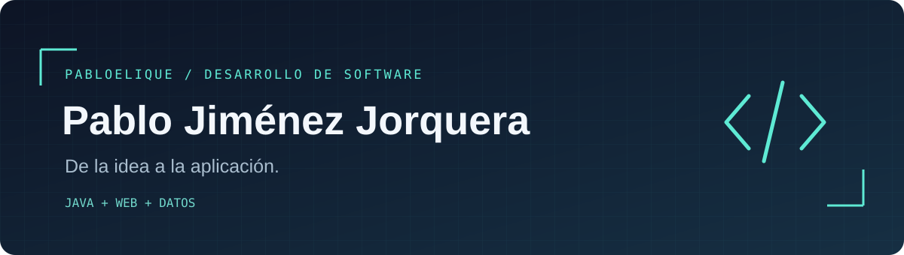

**Estudiante de 2.º DAM · Murcia · Busco prácticas en desarrollo de software**

[Portfolio](https://pabloelique.github.io/portfolio/) &nbsp; / &nbsp; [LinkedIn](https://www.linkedin.com/in/pablo-jimenez-jorquera-38b219309/) &nbsp; / &nbsp; [Contacto](mailto:pablojimenezjo2005@gmail.com)

## `01` Hola, soy Pablo

Estudio Desarrollo de Aplicaciones Multiplataforma en el **IES Alfonso X el Sabio**. Me gusta entender un problema, organizar una solución y convertirla en una aplicación que pueda explicar y seguir mejorando.

He trabajado con **Java y JavaFX** en aplicaciones de escritorio. Ahora estoy ampliando esa base al desarrollo web con **Angular, Node.js y PostgreSQL**. Busco unas prácticas en las que aprender del equipo y aportar trabajo, curiosidad y constancia.

## `02` Ahora construyendo → VoltaERP

**[VoltaERP](https://github.com/VoltaERP/VoltaERP)** es nuestro proyecto intermodular de segundo de DAM: un ERP web para una pequeña empresa, desarrollado en un **equipo de cinco personas**.

Participo en frontend, backend y base de datos. He trabajado en la gestión de usuarios, cambios de rol y activación de cuentas. Nos organizamos con Jira y sprints, y revisamos el código mediante pull requests.

`Angular` `TypeScript` `JavaScript` `Node.js` `Express` `PostgreSQL` `Sequelize` `Git` `Jira`

**Estado: en desarrollo.** El alcance previsto incluye clientes y proveedores, catálogo e inventario, ventas, compras e informes; los módulos se construyen por fases.

## `03` Proyectos que cuentan mi recorrido

| Proyecto | Lo que construimos | Explorar |
| :--- | :--- | :--- |
| **Clínica Miguel Marín** | Creación de la web de la clínica con **WordPress** y alojamiento en **Hostinger**. | [Visitar web](https://clinicamiguelmarin.com/) |
| **Garash Studio JF** | Aplicación de escritorio para gestionar clientes, empleados, citas, productos y facturación de una peluquería. **Java · JavaFX · FXML** | [Repositorio](https://github.com/Pabloelique/JFGARASHSTUDIO) |
| **El Profesor Python — escritorio** | Aventura gráfica de misterio, escenas y acertijos. Proyecto junto a Ayoub Atidi Belbaz. **Java 21 · Swing · AWT · Maven** | [Código](https://github.com/Ayoxb1/Aventura-Grafica-Profesor-Python) |
| **El Profesor Python — online** | Adaptación al navegador con cuaderno de pistas, escenas interactivas y audio. **React · Next.js · TypeScript** | [Código](https://github.com/Ayoxb1/Profesor-Python-Online) / [Jugar](https://profesor-python.vercel.app) |
| **Mi portfolio** | Una ventana a mis proyectos, formación y experiencia. **React · Vite · Tailwind CSS** | [Web](https://pabloelique.github.io/portfolio/) / [Código](https://github.com/Pabloelique/portfolio) |

## `04` Mi caja de herramientas

| Área | Tecnologías y conocimientos |
| :--- | :--- |
| Aplicaciones de escritorio | Java, POO, JavaFX, FXML, Scene Builder |
| Desarrollo web | HTML, CSS, JavaScript; Angular, Node.js y Express en VoltaERP |
| Datos | SQL, PostgreSQL, Sequelize, MongoDB, XML, XPath, XQuery |
| Trabajo en equipo | Git, GitHub, Jira, revisión de código, UML |
| Otros entornos | WordPress y Hostinger en clinicamiguelmarin.com; conocimientos de Linux y Docker |

## `05` Más allá del código

Antes de DAM completé dos cursos de Ingeniería Informática en la Universidad de Murcia. También he trabajado en almacén, taller y construcción: experiencias que me han enseñado a organizar tareas, colaborar y asumir responsabilidades.

**Español nativo · Inglés B2 sin certificación · Francés básico**  
Carnet B y vehículo propio. Disponibilidad para desplazamientos.

---

**Aprender → construir → revisar → mejorar**

¿Buscas un estudiante de DAM para prácticas? [Hablemos](mailto:pablojimenezjo2005@gmail.com).

